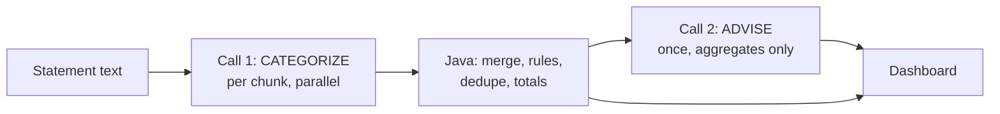

# How AI Is Used in SpendSense AI

AI is used for two jobs only: **(1) reading and categorising transactions** and **(2) writing the coaching text**. Everything numeric is computed by Java.

## 1. Provider and call mechanics

| Item | Value |
|---|---|
| Provider | OpenAI Chat Completions, `POST {baseUrl}/chat/completions` |
| Default model | `gpt-4o-mini` (`OPENAI_MODEL`) |
| Client | JDK `HttpClient`, no SDK |
| Output mode | `response_format: {"type":"json_object"}` |
| Temperature | 0.1 for consistency; resent without it if the model answers HTTP 400 about temperature |
| Messages | One `system` (instructions) + one `user` (data) |
| Timeout | 120 s per call (`llm.timeout-seconds`) |
| Interface | `LlmClient`, so providers are swappable |

## 2. The two AI calls

### Call 1: extract and categorise (`Prompts.CATEGORIZE`)

- **Input:** cleaned text of one chunk (about 25 transactions).
- **Task:** extract every transaction; return `date`, `details`, `utr`, `amount`, `type`, `category`, `selfTransfer`.
- **Constraints in the prompt:** never skip, merge or invent; ignore headers, footers and balances; use only the 14 listed category values; debit/credit rules ("Paid to" = DEBIT, "Received from" = CREDIT).
- **India-specific hints:** examples of truncated payees (BMRCL, RAILTEL CO, ZEPTO, SWIGGY, BESCOM…) mapped to categories.
- **Self-transfer rule:** own name, masked account such as `XXXX1234`, or words like "self" set `selfTransfer=true` and `INCOME_AND_TRANSFERS`.
- **Ambiguity rule:** ordinary personal UPI names with no merchant keyword become `OTHER_UNCATEGORIZED`, rather than a guess.
- **Output:** a single JSON object `{"transactions":[...]}` with no prose or code fences.

### Call 2: coaching narrative (`Prompts.ADVISE`)

- **Input:** only aggregates built in Java: total expenses, total income, spend per category (amount, share, count), and payees with 3 or more payments. No raw transactions are sent in this call.
- **Task:** produce `summary` (2–3 sentences), `insights` (4–6), `feedback` (4–6, such as category caps or a 50/30/20 check), `savingsTips` (4–6, with estimated monthly ₹ savings when supported).
- **Constraint:** "Use ONLY the aggregated numbers provided; never invent figures."
- **Limits:** one attempt, max 1,024 output tokens, 180 s timeout, because a retry of a slow call just repeats the wait.

## 3. What AI does vs. what code does

| Responsibility | Done by |
|---|---|
| Understand messy statement text | AI |
| Clean payee names and pick a category | AI |
| Detect self-transfers | AI (prompt rules) |
| Fix obvious merchant mislabels | Code (`CategoryRules`) |
| Force every credit to `INCOME_AND_TRANSFERS` | Code |
| De-duplicate by 12-digit UTR | Code |
| Totals, net flow, percentages, counts | Code |
| Recurring-payee detection (3+ payments) | Code |
| Summary, insights, feedback, savings tips wording | AI |
| Fallback text when AI fails | Code (`LocalInsights`) |

## 4. Guardrails against model mistakes

| Risk | Mitigation |
|---|---|
| Arithmetic errors | Models never produce totals; Java computes them from structured rows |
| Invalid or invented category | Prompt lists exact values; unknown enum values deserialize to `null` and become `OTHER_UNCATEGORIZED` |
| Case or wording drift | Case-insensitive enum mapping; unknown JSON fields ignored |
| Code fences or extra prose around JSON | `extractJson` keeps only the outermost `{ ... }` |
| Narrative in odd shapes (string instead of list, objects inside lists) | Reply is read as a JSON tree and each field coerced to text or a list |
| Wrong category on obvious merchants | `CategoryRules` keyword pass after the model |
| Credit labelled as spending | Credits always forced to `INCOME_AND_TRANSFERS` |
| Duplicate or overlapping rows | De-duplicate by UTR; rows with amount ≤ 0 or no type are dropped |
| Transient API errors | Up to 3 attempts per chunk with growing pause (1 s, 2 s) |
| Rate limits | Concurrency limit and optional `min-interval-ms` |
| One bad chunk | Chunk marked failed, others continue, user sees a warning |
| Narrative failure | `LocalInsights` produces an exact, rule-based summary and tips, plus a warning |
| Model returns blank fields | `LocalInsights.fillGaps` fills only the blanks |
| Secrets in errors | OpenAI error text truncated to 300 chars; user sees generic message |

## 5. Why chunking

- Keeps each prompt small, fast and cheap.
- Prevents long outputs from being truncated.
- Isolates failures to one slice.
- Enables parallel calls and an honest progress bar.
- Chunks hold **whole records only**, so a transaction is never split across prompts.

## 6. Cost and performance

- Calls per analysis = number of chunks + 1.
- Chunks ≈ transactions ÷ 25 (also bounded by 8,000 characters).
- Example: a statement with 100 transactions makes about 5 calls (4 chunks + 1 narrative). A statement that fits in one chunk makes 2.
- `gpt-4o-mini` keeps cost low. Use `gpt-4o` when accuracy on unusual layouts matters more than cost.
- Parallelism (`concurrency=2`) roughly halves wall-clock time versus sequential, subject to rate limits.

## 7. Privacy

- The cleaned statement text (including payee names and UTRs) is sent to OpenAI in Call 1. Call 2 receives only aggregates.
- The app stores nothing: no database, no files; jobs are kept in memory for 15 minutes.
- Prompts and raw replies are not logged unless `LOG_PAYLOADS=true`. Keep it off wherever logs are shared.
- Check your OpenAI account's data-retention settings and policies for your own compliance needs.

## 8. Limits of the AI approach

- Output is probabilistic: the same statement can occasionally categorise slightly differently. Low temperature reduces but does not eliminate this.
- Personal UPI names are deliberately left as uncategorized instead of guessed. Review these in the Transactions tab.
- The model sees only text; scanned images are rejected before reaching it.
- Unusual layouts may lose rows. The "Heads up" banner reports failed chunks, but a successful chunk with a missed row is not detectable by the app. Spot-check totals against your statement for important uses.
- Advice is general guidance, not financial advice.

## 9. How to change the AI behaviour

| Goal | Where |
|---|---|
| Edit instructions, hints, tone, bullet counts | `service/Prompts.java` |
| Add or fix keyword corrections | `service/CategoryRules.java` |
| Add or rename categories | `model/ExpenseCategory.java` **and** the category list in `Prompts.CATEGORIZE` |
| Change model, temperature, timeout | `application.yml` or env vars |
| Change chunk size or parallelism | `analyzer.chunking.*`, `analyzer.processing.*` |
| Use another provider | Implement `llm/LlmClient` |
| Offline fallback wording | `service/LocalInsights.java` |

After any prompt or rule change, run `mvn test`; the tests use fake model replies, so prompts must still be validated by uploading the sample statement against the real API.
