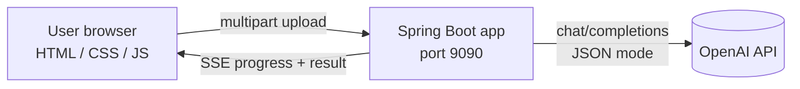
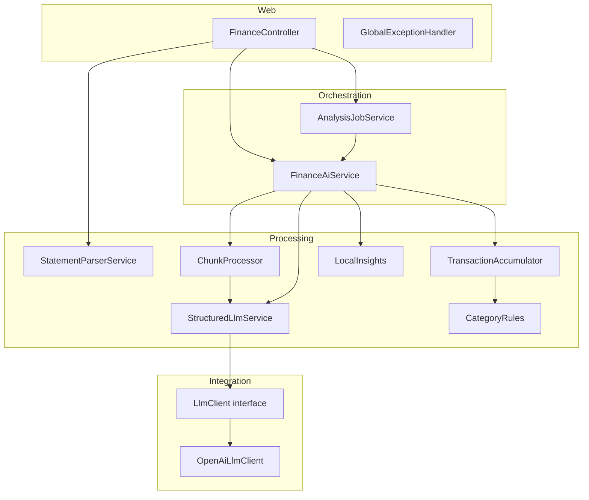
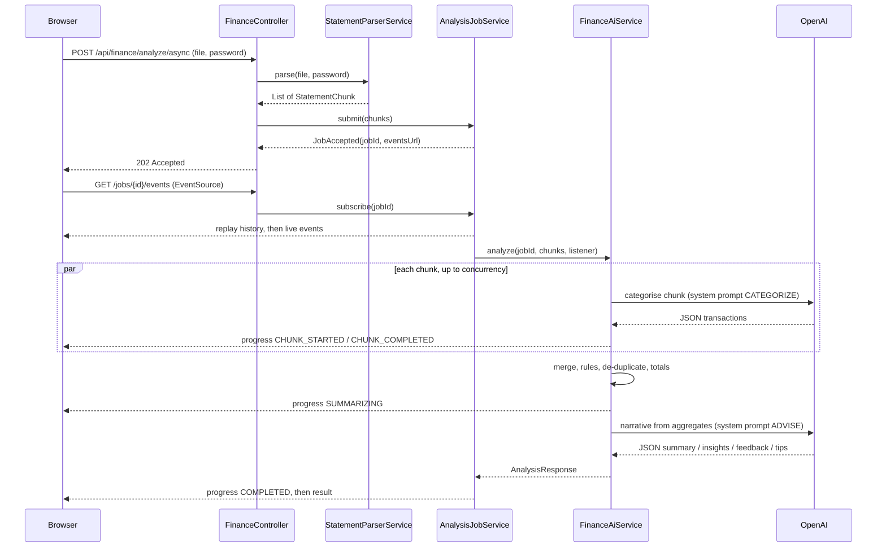
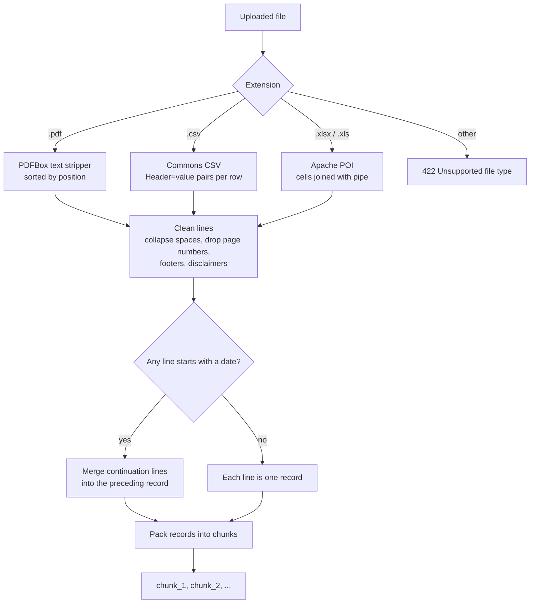
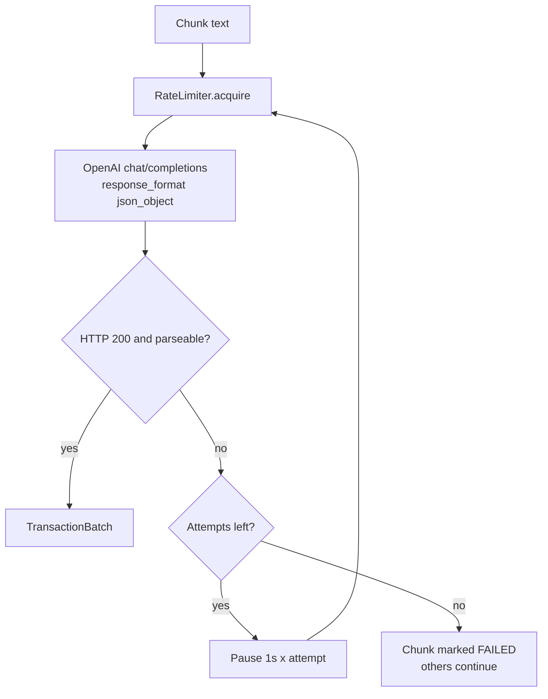
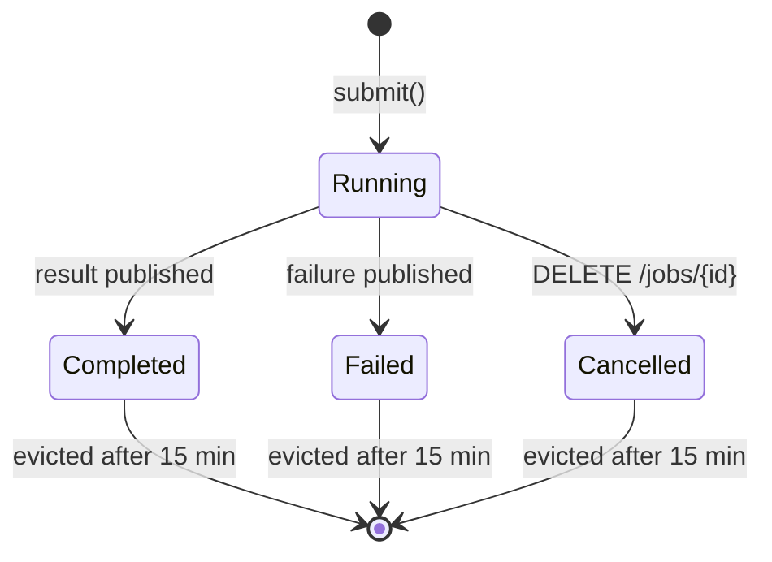

# Architecture and Flows

## 1. System context



A single Spring Boot process serves both the static dashboard and the REST API. There is no database and no message broker. Jobs live in memory.

## 2. Package layout

```
com.finance.analyzer
├── FinanceAnalyzerApplication      Spring Boot entry point
├── controller/
│   └── FinanceController           REST endpoints under /api/finance
├── service/
│   ├── StatementParserService      File to clean text to chunks
│   ├── AnalysisJobService          Background jobs, SSE streaming, cancel, retention
│   ├── FinanceAiService            Pipeline orchestrator, totals, narrative
│   ├── ChunkProcessor              One chunk to one LLM call to transactions
│   ├── StructuredLlmService        Retries, rate limit, JSON extraction and mapping
│   ├── TransactionAccumulator      Merge, validate, de-duplicate
│   ├── CategoryRules               Deterministic keyword corrections
│   ├── LocalInsights               Non-AI fallback summary and tips
│   ├── Prompts                     The two system prompts
│   ├── ProgressTracker             Percent complete maths
│   └── RateLimiter                 Minimum gap between LLM calls
├── llm/
│   ├── LlmClient                   Provider-neutral interface
│   ├── OpenAiLlmClient             OpenAI implementation (JDK HttpClient)
│   └── LlmHttp                     HTTP helpers
├── config/                         LlmProperties, AnalyzerProperties
├── dto/                            AnalysisResponse, StatementChunk, ProgressEvent, JobAccepted
├── model/                          ExpenseCategory (14 values, labels, colours)
└── exception/                      Typed exceptions + GlobalExceptionHandler
```

Static UI lives in `src/main/resources/static` (`index.html`, `css/styles.css`, `js/app.js`, `js/report.js`, vendored jsPDF).

## 3. Layered view



`LlmClient` is the seam for swapping providers: implement `model()` and `completeJson(...)` and the rest of the app is unchanged.

## 4. Main flow: async analysis (what the UI uses)



Parsing happens **before** the job is created, because the uploaded file is discarded when the request ends. Parse errors therefore return `422` immediately instead of arriving later over SSE.

## 5. Parsing and chunking



A chunk closes when it reaches `transactions-per-chunk` records (default 25) or would exceed `max-chars-per-chunk` (default 8000), whichever comes first. A chunk never splits a transaction.

## 6. Chunk processing and retry



- Default 3 attempts per chunk (`analyzer.processing.max-attempts`).
- If OpenAI returns HTTP 400 mentioning `temperature`, the client resends once without it (for models such as o-series or gpt-5 that only accept the default).
- A failed chunk never fails the job. It is counted in `failedChunks` and a warning is added. Only if **all** chunks fail does the job fail.

## 7. Post-processing and totals

```mermaid
flowchart LR
    A[Chunk results in order] --> B[Drop invalid rows<br/>amount <= 0, null type]
    B --> C[CategoryRules.apply<br/>keyword corrections]
    C --> D[De-duplicate on 12-digit UTR]
    D --> E[Exclude self-transfers<br/>and INCOME_AND_TRANSFERS]
    E --> F[Totals, category %,<br/>uncategorized count]
    F --> G[Recurring payees<br/>3 or more payments]
    G --> H[Narrative call]
    H -->|failure or blank fields| I[LocalInsights fallback]
```



Rules worth knowing:

- Credits are always forced to `INCOME_AND_TRANSFERS`. Money in is never a spending category.
- **Spend** = DEBIT transactions that are not self-transfers and not `INCOME_AND_TRANSFERS`.
- **Income** = CREDIT transactions that are not self-transfers.
- Rows without a 12-digit UTR are always kept, because identical payments can be genuinely separate.
- Percentages use one decimal place; amounts round to two.

## 8. Job lifecycle and SSE



- Every event is stored for the life of the job. A client that connects late, or reconnects after a network blip, gets the full history replayed.
- A heartbeat sends a `keep-alive` comment every 15 seconds so proxies do not close idle streams.
- The SSE connection has no timeout (`0`), because large statements can take minutes.
- At most `max-concurrent-jobs` (default 2) analyses run at once; others queue.
- Cancelling publishes `cancelled` first, then interrupts in-flight work, so late events from the interrupted thread are ignored.

## 9. Progress percentage

`ProgressTracker` adds `floor(100 / N)` per finished chunk, caps at 99 until the last chunk, then reports 100. With more than 100 chunks it uses proportional maths. The percentage never goes backwards, because updates and publishing share one lock.

## 10. Error handling

| Situation | Exception | HTTP |
|---|---|---|
| Empty file, wrong type, scan, wrong password, corrupt file | `StatementParseException` | 422 |
| LLM failed after retries, no transactions found | `AiProcessingException` | 502 |
| Unknown or expired job id | `JobNotFoundException` | 404 |
| File over 20 MB | `MaxUploadSizeExceededException` | 413 |
| Anything unexpected | `Exception` | 500 |

All errors use the body `{"message": "..."}`. Technical detail goes to logs only; users see safe text.

## 11. Concurrency model

| Pool | Size | Purpose |
|---|---|---|
| Job executor | `max-concurrent-jobs` (2) | Runs whole analyses |
| Chunk pool (per job) | `concurrency` (2), capped by chunk count | Parallel LLM calls |
| SSE heartbeat | 1 daemon thread | Keep-alives and eviction |

Total in-flight OpenAI calls can reach `max-concurrent-jobs × concurrency`. Lower `concurrency` if you hit HTTP 429.

## 12. Frontend flow

1. On load, fetch `/api/finance/categories` for labels and colours.
2. On **Analyze**, POST to `/analyze/async`, read `jobId` and `eventsUrl`.
3. Open an `EventSource`; update the progress bar on `progress`; render the dashboard on `result`.
4. **Cancel** calls `DELETE /jobs/{id}`.
5. **Download report** builds the PDF in the browser with jsPDF; nothing is sent back to the server.

## 13. Design decisions

| Decision | Reason |
|---|---|
| AI extracts, Java calculates | Models make arithmetic mistakes; totals must be exact |
| Chunking | Keeps prompts small and fast, isolates failures, allows parallelism and progress |
| JSON mode plus tolerant parsing | Small models vary their shape; extra prose and code fences are tolerated |
| Keyword rules after the model | Cheap, deterministic fix for obvious merchants |
| Local insights fallback | The Insights tab is never empty, even when the narrative call fails |
| In-memory jobs | Simple, no infrastructure; trade-off is no persistence or horizontal scaling |
| Provider interface | OpenAI today, another provider by adding one class |
